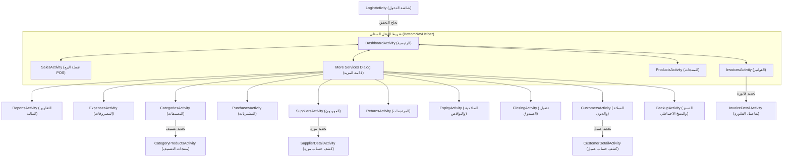

# خريطة الأساس لمشروع عمران هايبر (Amran_Hayper / com.lap1.mystore)

---

## 1. ملخص المشرووع العام (Project Overview)
* **اسم التطبيق في النظام:** عمران هايبر / متجري (`Amran_Hayper`)
* **اسم الحزمة (Package Name):** `com.lap1.mystore`
* **لغة البرمجة المستخدمة:** Java (JDK 11, Android SDK Target 36, Min SDK 24)
* **طريقة تصميم الواجهات:** XML Layouts (Material Design Components & AppCompat)
* **إدارة قاعدة البيانات:** SQLite عبر فئة مستقيمة `DatabaseHelper.java` (إصدار قاعدة البيانات **Version 16**)
* **تخزين الإعدادات والشفرات:** `SharedPreferences` (ملف `MyStorePrefs`)
* **تتبع الجلسة والمستخدم:** تجميع كلمة المرور عبر `PBKDF2WithHmacSHA256` مع `salt` عشوائي وتخزين اسم المستخدم في `users`.

---

## 2. الإحصائيات الفنية العامة (Technical Baseline Stats)
* **إجمالي ملفات Java البرمجية:** 31 ملفاً رئيساً في سورس التطبيق (بالإضافة إلى ملفي اختبارات وحدوية unit tests).
* **عدد الشاشات (Activities):** 19 شاشة فعالة (مع وجود كلاسين مهجورة/أولية هم `MainActivity` و `CategoryProductsActivity` في مجلد الجذر).
* **عدد ملفات التصميم (Layout XML):** 38 ملف تصميم XML (تتضمن الأنشطة، والحوارات Dialogs، وحاويات البطاقات Items).
* **إجمالي ملفات الموارد (Res XML):** 98 ملف XML (شاملة الأيقونات، الألوان، الثيمات، وقواعد النسخ والـ FileProvider).
* **إصدار قاعدة البيانات الحالية (DB Version):** 16
* **عدد جداول قاعدة البيانات:** 18 جدولاً مهيكلاً بالكامل مع تفعيل القيود المرجعية `FOREIGN KEY`.

---

## 3. خريطة قاعدة البيانات والجداول (Database Schema & Architecture)

تعتمد قاعدة البيانات `mystore.db` في الإصدار 16 على **18 جدولاً**، وهي كالتالي:

### أ. الجداول الأساسية والدعم:
1. `users`
   * **الأعمدة:** `id` (PK), `username` (UNIQUE), `password` (PBKDF2 Hash)
   * **الغرض:** إدارة حسابات الدخول إلى النظام والتشفير.
2. `categories`
   * **الأعمدة:** `id` (PK), `name`
   * **الغرض:** التصنيفات الرئيسية للمنتجات.
3. `products`
   * **الأعمدة:** `id` (PK), `name`, `barcode`, `category_id` (FK), `purchase_price`, `sale_price`, `quantity`, `min_quantity`, `expiry_date`, `alert_days`, `unit_name`, `unit_factor`, `is_weighted`, `is_archived`, `created_at`
   * **الغرض:** دليل الأصناف والمخزون، أسعار الشراء والبيع، وحدات القياس، والأرشفة بدلاً من الحذف النهائي عند وجود سجلات.
4. `customers`
   * **الأعمدة:** `id` (PK), `name`, `phone`, `address`, `balance`, `created_at`
   * **الغرض:** دليل العملاء ورصيد المديونية المستحق عليهم.
5. `suppliers`
   * **الأعمدة:** `id` (PK), `name`, `phone`, `balance`, `created_at`
   * **الغرض:** دليل الموردين ورصيد المستحقات الواجبة لهم.

### ب. جداول حركات البيع والشراء:
6. `sales`
   * **الأعمدة:** `id` (PK), `invoice_number`, `customer_id` (FK), `total`, `discount`, `tax`, `paid`, `remaining`, `payment_status`, `payment_method`, `notes`, `sale_date`
   * **الغرض:** رأس فواتير المبيعات الصادرة.
7. `sale_items`
   * **الأعمدة:** `id` (PK), `sale_id` (FK), `product_id` (FK), `quantity`, `unit_price`, `purchase_price`, `total`
   * **الغرض:** تفاصيل أصناف كل فاتورة مبيعات، مع تجميد سعر الشراء لحظة البيع لحساب COGS بدقة.
8. `purchases`
   * **الأعمدة:** `id` (PK), `supplier_id` (FK), `supplier_name`, `total`, `paid`, `remaining`, `payment_method`, `purchase_date`
   * **الغرض:** رأس فواتير المشتريات الواردة من الموردين.
9. `purchase_items`
   * **الأعمدة:** `id` (PK), `purchase_id` (FK), `product_id` (FK), `quantity`, `unit_price`, `total`
   * **الغرض:** أصناف فاتورة الشراء وتحديث مخزون الأصناف وتكلفة الشراء.

### ج. جداول السداد والمالية:
10. `payments`
    * **الأعمدة:** `id` (PK), `customer_id` (FK), `sale_id` (FK), `amount`, `payment_method`, `payment_date`, `notes`
    * **الغرض:** سندات المقبوضات وسداد الديون من العملاء.
11. `supplier_payments`
    * **الأعمدة:** `id` (PK), `supplier_id` (FK), `amount`, `payment_method`, `payment_date`, `notes`
    * **الغرض:** سندات المدفوعات لسداد حسابات الموردين.
12. `expenses`
    * **الأعمدة:** `id` (PK), `title`, `category`, `amount`, `expense_date`, `notes`
    * **الغرض:** تسجيل المصروفات التشغيلية للمحل.
13. `daily_closings`
    * **الأعمدة:** `id` (PK), `closing_date`, `physical_cash`, `system_cash`, `system_network`, `system_credit`, `difference`, `opening_cash`, `closed_at`, `notes`
    * **الغرض:** حفظ إغلاقات الصندوق وتقفيل الورديات وتوثيق العجز أو الزيادة.
14. `returns`
    * **الأعمدة:** `id` (PK), `sale_id` (FK), `product_id` (FK), `quantity`, `amount`, `purchase_price`, `debt_reduction`, `return_method`, `return_date`
    * **الغرض:** تسجيل مرتجعات المبيعات وتأثيرها على المخزون والدين والأرباح.
15. `stock_adjustments`
    * **الأعمدة:** `id` (PK), `product_id` (FK), `product_name`, `system_quantity`, `actual_quantity`, `difference`, `notes`, `created_at`
    * **الغرض:** توثيق تسويات الجرد المالي والمخزني وحالات التلف.

### د. جداول دفتر الحسابات العام والتوزيع المحاسبي (Phase 2 Upgrade):
16. `account_ledger`
    * **الأعمدة:** `id` (PK), `party_type` (CUSTOMER/SUPPLIER), `party_id`, `transaction_type` (OPENING, SALE, SALE_PAYMENT, PAYMENT, RETURN, PURCHASE, PURCHASE_PAYMENT), `reference_id`, `amount`, `transaction_date`, `notes`
    * **الغرض:** دفتر الحساب التسلسلي التراكمي الموحد للأطراف المالية، لحساب الأرصدة بدقة زمنية.
17. `customer_payment_allocations`
    * **الأعمدة:** `id` (PK), `payment_id` (FK), `sale_id` (FK), `amount`, `created_at`
    * **الغرض:** ربط دفعات السداد بفواتير البيع الآجلة المحددة (Fifo/Specific Allocation).
18. `supplier_payment_allocations`
    * **الأعمدة:** `id` (PK), `payment_id` (FK), `purchase_id` (FK), `amount`, `created_at`
    * **الغرض:** ربط دفعات المورد بفواتير الشراء المستحقة.

---

## 4. خريطة التنقل والجلسات (Navigation Architecture & Session Flow)

### آليات التنقل وحفظ الجلسات:
* **تسجيل الدخول والتذكر:** يتم تذكر اسم المستخدم عبر `SharedPreferences` (`remember_username`) عند اختيار "تذكرني".
* **التنقل الموحد:** يتم استدعاء `BottomNavHelper.navigateTo(currentActivity, TargetClass)` والتي تمنع تكرار الشاشات في Stack عبر أعلام `FLAG_ACTIVITY_CLEAR_TOP | Intent.FLAG_ACTIVITY_SINGLE_TOP`.
* **تمرير البيانات بين الأنشطة:**
  * `InvoiceDetailActivity`: تستقبل `SALE_ID` (int).
  * `CustomerDetailActivity`: تستقبل `CUSTOMER_ID` (int).
  * `SupplierDetailActivity`: تستقبل `SUPPLIER_ID` (int).
  * `CategoryProductsActivity`: تستقبل `category_id` (int) و `category_name` (String).
  * `ProductsActivity`: تستقبل `OPEN_ADD_DIALOG` (boolean) أو `SEARCH_QUERY` (String).

---

## 5. طرق الحسابات والمنطق المالي (Financial Logic & Accounting Formulas)

تعتمد الحسابات المالية في `DatabaseHelper` والأنشطة المرتبطة بها على القواعد التالية:

1. **إجمالي الفاتورة والصافي:**
   $$\text{Net Sale Total} = \text{Grand Total} - \text{Discount}$$
2. **تكلفة البضاعة المباعة (COGS):**
   $$\text{COGS} = \sum (\text{SaleItem.quantity} \times \text{SaleItem.purchase\_price}) - \sum (\text{Return.quantity} \times \text{Return.purchase\_price})$$
3. **الربح الإجمالي (Gross Profit):**
   $$\text{Gross Profit} = \sum ((\text{unit\_price} - \text{purchase\_price}) \times \text{quantity}) - \text{Sales Discounts} - \text{Returns Profit Effect}$$
4. **صافي الربح (Net Profit):**
   $$\text{Net Profit} = \text{Gross Profit} - \text{Total Expenses}$$
5. **رصيد حساب العميل (Customer Ledger Balance):**
   $$\text{Customer Balance} = \sum (\text{account\_ledger.amount for CUSTOMER})$$
   *(القيم الموجبة تعبر عن زيادة الدين، والسالبة تعبر عن السداد/الخصم).*
6. **رصid حساب المورد (Supplier Ledger Balance):**
   $$\text{Supplier Balance} = \sum (\text{account\_ledger.amount for SUPPLIER})$$
7. **السيولة النقدية المتوقعة في الدرج (Expected Cash in Drawer):**
   $$\text{Expected Cash} = \text{Opening Cash} + \text{Cash In (Sales + Payments)} - \text{Cash Out (Expenses + Cash Purchases + Cash Supplier Payments + Cash Returns)}$$

---

## 6. تصنيف الوظائف والمشاكل والنواقص (Gap Analysis Report)

### أ. وظائف موجودة وتعمل بكفاءة (A. Working Features):
1. **نقطة البيع (POS):** دعم الباركود والوزن للميزان الذكي، إضافة المنتجات للسلة، حساب الصافي وتخصيص البيع الآجل/الجزئي.
2. **إدارة المنتجات والمخزون:** إضافة وتعديل الأصناف، الأرشفة بدلاً من الحذف عند وجود فواتير، مسح الباركود عبر كاميرا ML Kit، تسوية الجرد المالي والتلف.
3. **إدارة المشتريات:** فاتورة مشتريات متعددة الأصناف مع تحويل الكراتين للحبات تلقائياً وتحديث تكلفة الشراء والمخزون في Transaction موحدة.
4. **دفتر الحسابات المتراكم:** تسجيل كشوفات حساب تفصيلية زمنية للعملاء والموردين وتخصيص الدفعات للفواتير المستحقة.
5. **تقفيل الصندوق والورديات:** حساب الكاش المتوقع والشبكة والآجل، ومقارنته بالنقدي الفعلي لاستخراج العجز والزيادة.
6. **الطباعة والتصدير:** مشاركة الفواتير وتصدير كشوفات الحسابات والتقارير بصيغة PDF و CSV/Excel.
7. **النسخ الاحتياطي والأمان:** نسخ قاعدة البيانات واستعادتها مع اختبار سلامة الجداول وإنشاء نقطة استرجاع أمان تلقائية قبل أي استعادة (`mystore_pre_restore_safety.db`).

### ب. وظائف موجودة لكنها ناقصة أو بحاجة لتحسين (B. Incomplete Features):
1. **إدارة الجلسات والصلاحيات:** زر "الصلاحيات" يعيد التوجيه حالياً لشاشة تغيير كلمة المرور بدون أدوار ومستويات صلاحية للمستخدمين (لا يوجد نظام أذونات للكاشير vs المدير).
2. **الطباعة المباشرة لبطاقات الإيصال (Thermal Receipts 58mm/80mm):** تعتمد طباعة الفواتير حالياً على توليد PDF عبر قياسات صفحة A4 العادية وليست طباعة حرارية سريعة بلوتوث/USB.
3. **طباعة الباركود:** لا توجد إمكانية لتوليد وطباعة ملصقات الباركود للأصناف من داخل التطبيق.
4. **الأرشفة والاسترجاع:** المنتجات المؤرشفة تظهر في قاعدة البيانات ولكن لا توجد واجهة لاستعراض المنتجات المؤرشفة وإلغاء أرشفتها.

### ج. وظائف غير موجودة حالياً (C. Missing Features):
1. **تعدد الخزائن والبنك:** عدم وجود شجرة حسابات مالية تفصل بين صندوق الكاش، حساب شبكة البنك، الخزينة الرئيسية.
2. **إدارة ضريبة القيمة المضافة (VAT):** حقل `tax` موجود في جدول `sales` ولكنه غير مفعل بالكامل في حسابات وشاشات POS والتقارير.
3. **تعدد الفروع والواجهات الشبكية:** التطبيق يعمل محلياً بالكامل offline دون مزامنة سحابية.

### د. مشاكل التنقل (D. Navigation Issues):
1. **ملفات مهجورة غير مستخدمة:** وجود `MainActivity.java` و `CategoryProductsActivity.java` في مجلد الجذر `com.lap1.mystore` مسجلة في Manifest ولكن الأنشطة الفعلية تقع في `com.lap1.mystore.activities`.
2. **أزرار الرجوع وشريط Navigation:** بعض الشاشات الفرعية تستخدم `finish()` وبعضها يستخدم `BottomNavHelper.navigateTo` مما يخلق اختلافاً في سلوك زر الرجوع لمنع تراكم الـ BackStack.

### هـ. مشاكل UI/UX (UI/UX Issues):
1. **قوائم ListView التقليدية:** الاعتماد الكامل على `ListView` و `BaseAdapter` بدلاً من `RecyclerView` الموصى به في Android الحديث لأداء وتأثيرات أسرع.
2. **إدخال المبالغ بداخل الحوارات Simple Dialogs:** الاعتماد على `dialog_add_simple.xml` الذي يعيد استخدام حقل الاسم كحقل للمبلغ أو الكمية مما يؤدي لإرباك المستخدم وإرشادات هينت غير دقيقة.

### و. مشاكل بنية قاعدة البيانات (F. Database Architecture Issues):
1. **عدم التوافق في أنواع البيانات بين Models و Database:** الكلاس `Product.java` يمثل الكميات كـ `int` في حين أنها في قاعدة البيانات والشاشات تُخزن كـ `double` لدعم الأوزان والكسور.
2. **التحويل والتاريخ المحلية:** استعلامات التاريخ تعتمد في بعض المواضع على `date('now', 'localtime')` وفي مواضع أخرى على `datetime(sale_date)` أو UTC مما قد يسبب تفاوتات طفيفة عند اختلاف التوقيت.

### ز. مخاطر محتملة على البيانات والحسابات (G. Data & Calculation Risks):
1. **الحذف المباشر للمصروفات:** يتم حذف المصروفات نهائياً بـ `DELETE` دون الاحتفاظ بسجل تاريخي أو أرشفة للمصروفات المحذوفة.
2. **تعديل المنتجات أثناء البيع:** إذا تم تغيير سعر الشراء لمنتج، فإن فواتير المبيعات القديمة المحفوظة تستخدم `purchase_price` المخزن في `sale_items` (وهو تصرف صحيح تُم تطبيقه لحماية COGS)، ولكن يجب التأكد من عدم المساس بهذا المنطق مستقبلاً.

---

## 7. الملفات الحساسة مالياً ومحاسبياً (Critical Calculation Files)

⚠️ **تنبيه هام:** الملفات التالية تحتوي على معادلات الحسابات، الدفتر المحاسبي، الأرباح، والمخزون، ويُحظر تغيير المنطق البرمجي بداخلها بدون اختبارات دقيقة:

1. `app/src/main/java/com/lap1/mystore/database/DatabaseHelper.java` (إصدار DB، التراكمي المحاسبي، معادلات الأرباح، COGS، السيولة النقدية وتقفيل الصندوق).
2. `app/src/main/java/com/lap1/mystore/activities/SalesActivity.java` (حساب الصافي، الخصومات، خصم المخزون، تسجيل الدفاتر للعميل).
3. `app/src/main/java/com/lap1/mystore/activities/PurchasesActivity.java` (تحويل الكراتين إلى حبات، تحديث أسعار الشراء، والمخزون والموردين).
4. `app/src/main/java/com/lap1/mystore/activities/CustomerDetailActivity.java` (توزيع الدفعات وتوليد كشف الحساب والـ PDF المحاسبي).
5. `app/src/main/java/com/lap1/mystore/activities/SupplierDetailActivity.java` (توزيع دفعات الموردين وتوليد كشف حساب المورد).
6. `app/src/main/java/com/lap1/mystore/activities/ReturnsActivity.java` (حساب مرتجعات البيع والتأثير على مخزون المنتجات ودين العميل وسعر الشراء التاريخي).
7. `app/src/main/java/com/lap1/mystore/activities/ClosingActivity.java` (منطق تقفيل الصندوق وحساب العجز والزيادة والسيولة).
8. `app/src/main/java/com/lap1/mystore/activities/ReportsActivity.java` (حسابات التقارير المالية الشاملة وتصدير CSV/PDF).

---

## 8. التوصيات الموصى بها لترتيب مراحل التطوير القادمة (Recommended Roadmap)

1. **المرحلة 1: تنظيف البنية وإزالة الملفات المهجورة (Clean & Refactor Baseline)**
   * تنظيف الملفات المكررة والمهجورة في جذر الحزمة (`MainActivity`, `CategoryProductsActivity` اليدوية).
   * توحيد نماذج البيانات (`Product`, `SaleItem`) لتكون `double` للكميات للتوافق مع قاعدة البيانات.
2. **المرحلة 2: تعزيز الأمان والصلاحيات (Permissions & Roles)**
   * فصل صلاحيات "الكاشير" عن "المدير" وتأشير العمليات الحساسة (مثل حذف المصروفات، تعديل الأسعار، إلغاء الفواتير).
3. **المرحلة 3: تحسين تجربة واجهات المستخدم والـ POS (UI/UX & POS Enhancements)**
   * تحديث قوائم المنتجات والسلة إلى `RecyclerView`.
   * دعم الطباعة الحرارية المباشرة طابعات البلوتوث/USB (58mm/80mm).
4. **المرحلة 4: إدارة الأرشيف والضريبة وتطوير الميزات (Advanced Features)**
   * إضافة شاشة لاسترجاع الأصناف المؤرشفة.
   * تفعيل ضريبة القيمة المضافة بشكل اختياري في الفواتير والتقارير.

